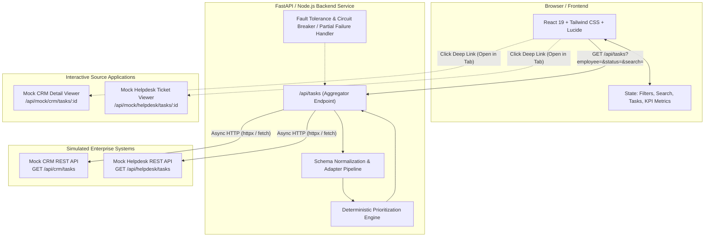
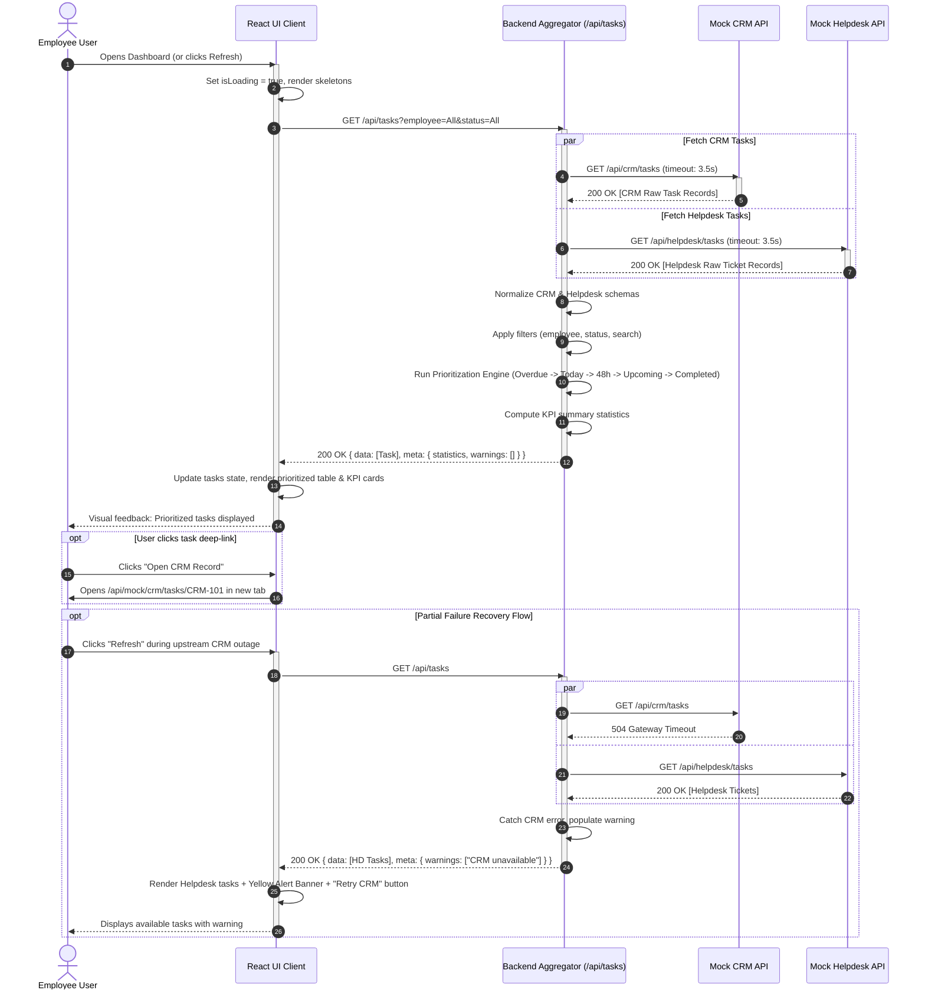

# Architecture Design Document: Employee Task Dashboard

**Project**: Employee Task Dashboard  
**Architecture Style**: Decoupled Client-Server with API Gateway / Aggregator Pattern  
**Status**: Step 1 - Approved Technical Blueprint  

---

## 1. System Architecture Overview

The Employee Task Dashboard employs an **API Aggregation & Adapter Pattern**. Rather than having the browser make multiple round-trips to heterogeneous third-party services with divergent data models, CORS challenges, and error-handling complexities, a unified backend aggregator acts as the single point of contact.

---

## 2. Component Responsibilities

### 2.1 React Frontend Client
- **View Presentation**: Renders the desktop sidebar, responsive header, KPI metric cards, filter toolbar, and task table/cards.
- **State Management**:
  - `filters`: `{ employee: string, status: string, search: string }`
  - `tasks`: Array of canonical `Task` items.
  - `metadata`: `{ total: number, statistics: KPIStats, warnings: Warning[] }`
  - `uiState`: `{ isLoading: boolean, isRefreshing: boolean, error: ErrorState | null }`
- **User Interactions**:
  - Immediate filter updates and debounced keyword search.
  - One-click manual refresh.
  - Clean external navigation with `target="_blank" rel="noopener noreferrer"`.
  - Dismissible alert banners for partial source degradations.

### 2.2 Backend Aggregator (FastAPI / Express)
- **Concurrent Ingestion**: Fires parallel non-blocking HTTP requests to CRM and Helpdesk endpoints (`asyncio.gather` with timeouts).
- **Schema Normalization**: Translates divergent schemas (field names, datetime formats, urgency enums, status codes) into the canonical `Task` model.
- **Deduplication & Conflict Resolution**: Generates synthetic globally unique IDs (`CRM-101`, `HD-502`) to prevent ID collisions.
- **Filtering & Search**: Applies query-level filtering (`employee`, `status`, `search`) across the merged dataset.
- **Deterministic Prioritization**: Computes the 5-tier deadline + urgency ranking using an injectable UTC timestamp.
- **Fault-Tolerant Resilience**:
  - If CRM fails, Helpdesk data is returned with `warnings: ["CRM service unavailable"]`.
  - If Helpdesk fails, CRM data is returned with `warnings: ["Helpdesk service unavailable"]`.
  - If both fail, HTTP 502/503 is returned with structured diagnostic payload.

---

## 3. End-to-End Sequence Diagram

The following sequence diagram outlines the entire request lifecycle, from initial render to error recovery.

---

## 4. Upstream Integration Strategy: Co-located vs. Independent

In this architecture, we distinguish between two deployment configurations:

1. **Production / Multi-Service Configuration**:
   - The CRM service runs as an independent microservice at `http://crm-service:8001`.
   - The Helpdesk service runs as an independent microservice at `http://helpdesk-service:8002`.
   - The Aggregator calls them via full network HTTP requests over private VPC or public endpoints with authentication headers.

2. **Prototyping / Evaluation Configuration (This Project)**:
   - To ensure deterministic, self-contained evaluation without requiring external cloud accounts or third-party uptime, the mock CRM and Helpdesk endpoints (`/api/crm/tasks` and `/api/helpdesk/tasks`) are mounted within the server application.
   - However, the aggregator communicates with them via **genuine loopback HTTP calls** (`http://127.0.0.1:PORT/api/...`) rather than internal in-memory function calls. This strictly enforces:
     - Real network serialization/deserialization.
     - Authentic HTTP headers, status codes, and timeouts.
     - Real network latency simulation and isolated failure modes.
     - Complete fidelity to production distributed architectures.

---

## 5. Technology Stack Selection & Rationale

| Layer | Chosen Technology | Rationale & Alternatives Considered |
|---|---|---|
| **Frontend Framework** | **React 19 + Vite** | Instant build feedback, standard in enterprise applications, rich component ecosystem. Preferred over Next.js for pure dashboard simplicity. |
| **Styling & Icons** | **Tailwind CSS v4 + Lucide React** | Utility-first design ensures zero unused CSS bloat, exact brand consistency, dark/light contrast accessibility, and recognizable iconography. |
| **Backend Framework** | **Python (FastAPI + Pydantic + HTTPX)** / **Node.js (Express + TS)** | FastAPI provides automatic OpenAPI documentation, asynchronous I/O (`asyncio`), high-performance data validation via Pydantic v2, and clean type safety. If deployed inside a unified single-port Node/Vite container, Express + TypeScript provides identical asynchronous aggregation semantics. |
| **Data Fetching** | **Native Fetch API / Axios** | Clean abort controller support, typed request/response interceptors, zero superfluous dependencies. |
| **Testing** | **Pytest / Vitest + React Testing Library** | Pytest handles mock clock injection and parameterized sorting tests. Vitest provides fast, in-memory component assertion without browser overhead. |
